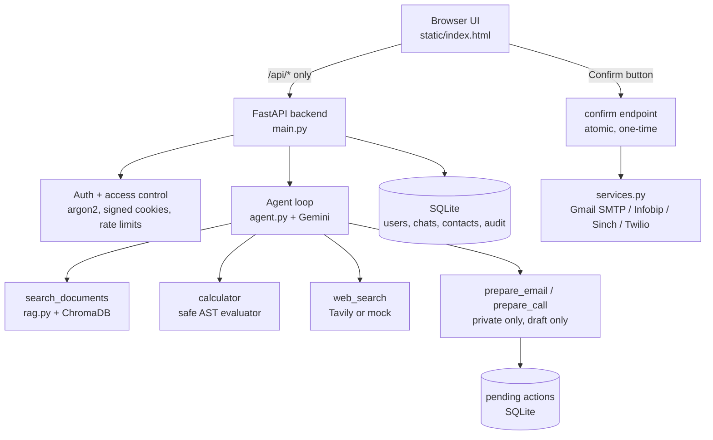

# Agent Conflux 2.1

  

**Document intelligence, tool-using agents and confirmed outreach in a single interface.**

Agent Conflux is an AI assistant with two workspaces in one web application:

- **Public Chat** – ask questions about your own documents (RAG with citations), do exact calculations, and search the web.
- **Private Work** – sign in, keep a contact list, and tell the assistant to *email* or *phone* someone. It writes the draft, **you confirm**, and only then is anything sent.

The project is modular: each capability is a registered tool, and every provider (LLM, web search, email, telephony) can be swapped or run in mock mode for safe testing.

> **Status:** prototype (v2.1) for a single user on a local machine. See [Known limitations](#known-limitations) and [Roadmap](#roadmap) for what is and isn't built.

---

## Table of contents

1. [Features](#features)
2. [How it works](#how-it-works)
3. [Technology stack](#technology-stack)
4. [Project structure](#project-structure)
5. [Quick start](#quick-start)
6. [Configuration (.env)](#configuration-env)
7. [Using the app](#using-the-app)
8. [Email and phone providers](#email-and-phone-providers)
9. [Security model](#security-model)
10. [API reference](#api-reference)
11. [Troubleshooting](#troubleshooting)
12. [Known limitations](#known-limitations)
13. [Roadmap](#roadmap)
14. [License](#license)

---

## Features

**Chat and history**
- Clean chat interface with a Public Chat / Private Work switch.
- Saved conversations with create, rename, delete and history. Public and private histories are kept separate.
- Answers render **Markdown** (headings, bold, lists, tables, code) and **LaTeX formulas** (real fractions, roots, powers).
- Every answer shows where it came from, with text labels (not colour alone):
  `Uploaded Document`, `Agentic Search`, `Calculative Source`, `Private Action`, `AI Knowledge`, or `No source found`. Combined answers show e.g. `Sources: Uploaded Document + Calculative Source`.

**Documents and RAG (Public Chat)**
- Upload **PDF, TXT, DOCX** (max 10 MB). Word tables are read as well as paragraphs.
- Text is chunked (800 characters, 120 overlap), embedded locally and stored in a ChromaDB vector store.
- Retrieval uses a similarity threshold and per-user filtering. Vague questions fall back to the closest passages.
- Answers cite the file and page. If nothing relevant exists, the assistant says it couldn't find enough information in the uploaded documents.

**Agent with tools**
- Google Gemini decides which tool to call (function calling), for up to 5 steps per question and a 100-second overall limit.
- Tools: document search, exact calculator, web search, and (Private Work only) email and phone drafting.

**Private Work (email and phone)**
- Sign-in with a hashed password and a signed session cookie.
- A **Contacts** panel: name + email and/or phone (with country code), editable at any time.
- Say *"Email the driver that I'll be 30 minutes late"* or *"Call Rahul and tell him the meeting is at 9 PM"*. The backend matches the spoken name to one saved contact, the AI writes the draft, and a card shows the recipient and text with **Confirm** and **Cancel**.
- Nothing is sent until you press Confirm. A draft expires after 10 minutes and can be confirmed only once.
- **Mock mode is the default**: it only logs, so you can test safely without contacting anyone.

---

## How it works



**Agent design.** One orchestrator (Gemini) chooses among registered tools. Each tool has a name, description, parameters and a permission flag in a registry in `agent.py`; adding a tool means adding one entry. Security does **not** depend on the model: tool permissions, ownership checks, confirmation, expiry and rate limits are enforced in backend code.

**Prompt-injection stance.** Text from documents and web pages is treated as untrusted data, never as instructions. The email and phone tools can only create drafts. Sending happens only through the confirm endpoint, which the model cannot call.

---

## Technology stack

| Layer | Choice |
|---|---|
| Backend | Python 3.10+, FastAPI, Uvicorn, SQLite |
| LLM | Google Gemini API (key from Google AI Studio), called over REST with `httpx` |
| Embeddings / vector store | ChromaDB with its built-in local embedding model (no API key) |
| Document parsing | `pypdf`, `python-docx` |
| Web search | Tavily, or built-in mock results |
| Auth | `argon2-cffi` password hashing, `itsdangerous` signed session cookies |
| Email | Gmail SMTP with an App Password |
| Phone | Infobip (default), Sinch or Twilio, via a provider switch |
| Frontend | One HTML file, vanilla JavaScript; `marked`, `DOMPurify`, `KaTeX` loaded from cdnjs; Inter and JetBrains Mono from Google Fonts |

---

## Project structure

```
agent-conflux/
├── main.py              # FastAPI app: auth, chats, uploads, contacts, confirm/cancel, rate limits
├── agent.py             # Tool registry, Gemini function-calling loop, retries/fallback
├── rag.py               # Extraction, chunking, embeddings, retrieval (ChromaDB)
├── services.py          # Outbound providers: email + phone, mock mode, startup status
├── db.py                # SQLite schema and helpers
├── reset_password.py    # Reset or create the Private Work login
├── check_gemini.py      # Tests your Gemini key, models and connection speed
├── static/
│   └── index.html       # Single-page web interface
├── requirements.txt
├── .env.example         # Placeholders only
├── .gitignore           # Excludes .env, conflux.db, chroma_data/
└── README.md
```

Created at runtime and **never committed**: `.env`, `conflux.db`, `chroma_data/`.

---

## Quick start

```bash
git clone <your-repo-url>
cd agent-conflux
pip install -r requirements.txt
```

1. Copy the config file: `cp .env.example .env` (Windows: `copy .env.example .env`).
2. Generate a session secret and paste it as `SESSION_SECRET`:
   `python -c "import secrets;print(secrets.token_hex(32))"`
3. Add your Gemini API key as `LLM_API_KEY` (from https://aistudio.google.com/apikey).
4. Start the server: `python -m uvicorn main:app --reload`
5. Open http://127.0.0.1:8000

On startup the terminal prints the database location and a status line such as
`Phone: MOCK (MOCK_PHONE is true) | Email: MOCK (MOCK_EMAIL is true)`.

The first document upload downloads a small embedding model, so you need internet that one time.

**After editing `.env`, stop and restart the server.** Auto-reload does not watch `.env`.

---

## Configuration (.env)

| Variable | Purpose |
|---|---|
| `SESSION_SECRET` | Signs session cookies. Required. |
| `DATABASE_URL` | SQLite file name (default `conflux.db`, stored next to `main.py`). |
| `LLM_API_KEY` | Gemini API key. Without it the app runs in basic mode (document search only). |
| `GEMINI_MODEL` | Model name (default `gemini-2.5-flash`). If rejected, the app tries other Flash models your key can use. |
| `WEB_SEARCH_API_KEY` | Tavily key for real web search. |
| `MOCK_WEB_SEARCH` | `true` returns fake placeholder results; set `false` with a key for real search. |
| `DOCUMENT_ONLY` | `true` disables web search entirely. |
| `MOCK_EMAIL` | `true` (default) logs instead of sending. |
| `EMAIL_ADDRESS`, `EMAIL_APP_PASSWORD` | Gmail address and 16-character App Password. |
| `MOCK_PHONE` | `true` (default) logs instead of calling. |
| `PHONE_PROVIDER` | `infobip` (default), `sinch` or `twilio`. Only this provider is used. |
| `INFOBIP_API_KEY`, `INFOBIP_BASE_URL`, `INFOBIP_FROM`, `INFOBIP_LANGUAGE` | Infobip settings. `INFOBIP_FROM` is digits only (no `+`), copied from the portal's ready-made voice request. |
| `SINCH_APPLICATION_KEY`, `SINCH_APPLICATION_SECRET`, `SINCH_CLI` | Sinch settings. |
| `TWILIO_SID`, `TWILIO_TOKEN`, `TWILIO_FROM` | Twilio settings (custom spoken messages need a paid account). |

All keys stay on the server. The browser only talks to `/api/*`, and `/api/config` returns on/off flags, never secrets.

---

## Using the app

**Public Chat**
1. Press **Attach** and upload a PDF, TXT or DOCX.
2. Ask about it ("Summarize my report"), calculate ("What is 25% of 800?"), or ask for current information.
3. Check the source badge on each answer.

**Private Work**
1. Press **Private Work**. The first time, enter a username and a password of 10+ characters and press **Create account**. Afterwards just sign in.
2. Press **+ Add contact** and save names the way you'll say them, e.g. "Driver" with an email and/or phone like `+919876543210`.
3. Type a request such as *"Email the driver: I'll be 30 minutes late"*.
4. Review the draft card and press **Confirm & send email** (or **Confirm & place call**), or **Cancel**.
5. The card then shows the real result, or the provider's error. In mock mode it states that nothing was actually sent.

Forgot the login? Run `python reset_password.py` in the project folder. It shows the stored username and lets you set a new password. Contacts and chats are kept.

---

## Email and phone providers

Both are in **mock mode by default**. Turn real sending on only after filling the credentials and setting the matching `MOCK_*` value to `false`.

### Email: Gmail SMTP
- Turn on 2-Step Verification, create an **App Password** in your Google Account, and put it in `EMAIL_APP_PASSWORD`.
- Messages sent this way may not appear in your Gmail "Sent" folder.
- An App Password gives access to the whole mailbox. Keep `.env` private. Gmail OAuth would be tighter and is on the roadmap.

### Phone: automated text-to-speech call
The app speaks your exact typed message (max 600 characters) and the call ends. No recording, no speech recognition, no conversation.

| Provider | Account-tier constraints (per provider documentation) |
|---|---|
| **Infobip** (default) | Trial accounts: limited outgoing calls, **verified recipient numbers only**, 5 minutes per call. Voice may need to be enabled for your destination country. Adding funds converts the account to paid billing. |
| Sinch | Trial credits, verified numbers only. |
| Twilio | Trial accounts cannot speak custom messages through the API (fixed templates only). Needs a paid account for this feature. |

Caller ID: the recipient sees the sender number the provider assigns, which may not be your own number. The app never spoofs a caller ID.

"Accepted by the provider" is not the same as "delivered". The card says so, and the provider's own log is the source of truth for delivery.

---

## Security model

- **Secrets** live only in `.env` on the server. Never commit `.env`; `.env.example` has placeholders only.
- **Passwords** are hashed with argon2. Sessions are signed, HTTP-only cookies that expire after 8 hours.
- **Public/private isolation:** every chat, document, vector chunk, contact and action carries an owner ID, and every query filters on it. Private routes require a valid session.
- **Confirmation gate:** email and call tools only create pending drafts. The confirm endpoint checks the owner, that the draft is still pending and not expired, and flips its state atomically before sending, so a double click cannot send twice.
- **Contact privacy:** the model never receives the contact list. The backend resolves the spoken name to one contact and returns only that result.
- **Input handling:** email subjects have line breaks stripped (header-injection protection); call text is stripped of control characters; phone numbers must be E.164; the Infobip address must be an `infobip.com` host.
- **Rate limits:** 5 login attempts per minute per IP, 20 messages per minute per user, 20 confirmed actions per hour. (In-memory; they reset when the server restarts.)
- **Audit log:** records only who, kind of action, result and recipient label, never message text.
- **Rendering safety:** model output is sanitised with DOMPurify before it is displayed.

---

## API reference

All routes are under `/api`. `{scope}` is `public` or `private`; private routes return 401 without a valid session.

| Method | Route | Purpose |
|---|---|---|
| POST | `/auth/register` | Create the single private account (only works once) |
| POST | `/auth/login`, `/auth/logout` | Sign in / out |
| GET | `/auth/me`, `/config` | Session state and on/off flags (no secrets) |
| GET, POST | `/{scope}/chats` | List / create conversations |
| PATCH, DELETE | `/{scope}/chats/{id}` | Rename / delete |
| GET | `/{scope}/chats/{id}/messages` | Messages, including pending action cards |
| POST | `/{scope}/chats/{id}/send` | Send a message to the agent |
| GET, POST | `/{scope}/docs` | List / upload documents |
| DELETE | `/{scope}/docs/{id}` | Remove a document and its vectors |
| GET, POST | `/private/contacts` | List / add contacts |
| PATCH, DELETE | `/private/contacts/{id}` | Edit / delete a contact |
| POST | `/private/actions/{id}/confirm` | Send the pending email or call |
| POST | `/private/actions/{id}/cancel` | Cancel a pending draft |

Interactive docs: http://127.0.0.1:8000/docs

---

## Troubleshooting

| Symptom | Cause and fix |
|---|---|
| "Gemini did not answer in time" | Google is busy or your connection is slow. The app retries and switches models; run `python check_gemini.py` to see which models respond. VPN, proxy, firewall or antivirus can also cause it. |
| "Gemini error 4xx" | Message shows Google's own reason (invalid key, quota, unknown model). Fix `LLM_API_KEY` / `GEMINI_MODEL` and restart. |
| "Gemini on" in the sidebar but errors | It only means a key is present, not that Google accepted it. |
| Answers say "No source found" | Normal for errors and for "not found" replies. `AI Knowledge` means Gemini answered without using a tool. |
| Still "Mock mode" with `MOCK_PHONE=false` | The card and startup line name the reason: `.env` not reloaded (restart the server), wrong `PHONE_PROVIDER`, or an empty provider value. |
| "Already set up" or invalid login | Only one private account exists. Run `python reset_password.py`. Each copy of the project folder has its own `conflux.db`. |
| Twilio "400 … trial accounts have limited parameter access" | Twilio trials can't speak custom text. Use another provider or keep mock mode. |
| Infobip rejection in the portal log (e.g. account not provisioned, destination not allowed) | The Voice channel or the recipient number isn't enabled on the trial account. Add the recipient as a verified number in the portal, or request the Voice channel there. |
| Uploaded Word file seems empty | Image-only or text-box content isn't read. Delete and re-upload a text-based file. |

---

## Known limitations

- Private Work is a **single-user** prototype (one account). Multi-user support is not built.
- Provider tiers apply: Gemini rate limits, Tavily credits, and telephony trial restrictions (verified recipients only, limited call allowances). Calling arbitrary numbers in production requires a paid telephony account.
- Web search is mock data until you add a Tavily key and set `MOCK_WEB_SEARCH=false`.
- Email uses a Gmail App Password rather than OAuth.
- Rate limits are in memory and reset on restart.
- Markdown/LaTeX libraries and fonts load from CDNs, so the browser needs internet for the best display (it falls back to plain text).
- Phone delivery status is not tracked inside the app; check the provider's log.
- No automated test suite is included yet.

---

## Roadmap

- Image and screenshot understanding (OCR / vision)
- CSV and Excel analysis
- Document comparison and report generation (Markdown / DOCX / PDF)
- Evaluation suite (retrieval, tool choice, guardrails, confirmation enforcement)
- Gmail OAuth with send-only permission
- Delivery-status tracking for calls
- Multi-user support with fully isolated data
- Bundling frontend libraries for offline use


## Run (3 steps)
1. `pip install -r requirements.txt`  (Python 3.10+)
2. `cp .env.example .env` (Windows: `copy .env.example .env`), then set `SESSION_SECRET`. Add `LLM_API_KEY` (free Gemini key) for the full agent.
3. `uvicorn main:app --reload` and open http://127.0.0.1:8000

Private mode: press Private, then Create account once (10+ char password); afterwards just sign in.
The first document upload downloads a small local embedding model, so you need internet that one time.

## Layout
- `main.py` API, auth, access control, rate limits
- `agent.py` tool registry + agent loop (add a tool = add one entry in `TOOLS`)
- `rag.py` ingestion, chunking, local embeddings, retrieval; `db.py` SQLite
- `static/index.html` the UI (talks only to `/api/*`)

## Keys stay private
Keys live only in `.env` on the server. The browser calls `/api/*` and never receives a key; `/api/config` returns only on/off flags. Check: browser DevTools, Network tab, search responses for your key. `.env` is in `.gitignore`.

## Not built yet
Email and phone (with confirmation), image/OCR, CSV analysis, reports, evals.

## Troubleshooting
- Chat shows "Gemini error ...": the message is Google's own reason (invalid key, quota, model not available). Fix `LLM_API_KEY` / `GEMINI_MODEL` in `.env`, then restart `uvicorn`. `.env` is read only at startup.
- "AI: Gemini on" in the sidebar only means a key is present, not that Google accepted it.

## Private Work (email and phone)
Press **Private Work**, sign in, then add contacts in the sidebar (name + email and/or phone with country code). Say "Email the driver that I'm 30 minutes late" or "Call Rahul and tell him the meeting is at 9 PM". The assistant writes a draft; **nothing leaves until you press Confirm**. A draft expires after 10 minutes and can only be confirmed once. Mock mode (default) only logs; real sending needs the EMAIL_/TWILIO_ values in `.env` and `MOCK_EMAIL=false` / `MOCK_PHONE=false`. Email uses a Gmail App Password in `.env` (server-side only); Gmail OAuth is a possible later upgrade.

## Forgot the login, or "already set up"?
Private Work has one account. Run `python reset_password.py` in the project folder: it shows the stored username and lets you set a new password. Contacts and chats are kept. The database file is `conflux.db` next to `main.py`; if you keep several copies of the project folder, each has its own login.

## Phone calls and Twilio trial accounts
Twilio trial accounts only allow fixed sample calls through the API, so a custom spoken message fails with "400 ... trial accounts have limited parameter access". Email works fully on free tools. For real calls, upgrade the Twilio account (pay-as-you-go), otherwise keep `MOCK_PHONE=true`.

## Free phone calls with Sinch (trial)
Set `PHONE_PROVIDER=sinch`, fill the SINCH_ values, set `MOCK_PHONE=false`. Sinch trial: you can only dial numbers verified in the Sinch dashboard (Numbers menu; the recipient receives a code), with limited test credits and one call at a time. The call speaks your text (max 600 characters) and ends. The caller ID is the number in `SINCH_CLI`.

## Free phone calls with Infobip (trial) - default provider
Sign up at infobip.com, verify your number, add the recipient as a verified number, then in `.env` set `PHONE_PROVIDER=infobip`, the INFOBIP_ values, and `MOCK_PHONE=false`. Trial limits: 15 outgoing calls in total, verified numbers only, 5 minutes per call, 60 days. The recipient may see an Infobip number rather than yours. Do not "Add funds": that ends the trial and starts billing.

## Gemini timeouts
"did not answer in time" means Google did not reply within about 35 seconds. The app retries, switches to another Flash model and turns Gemini's slow "thinking" off, then gives up after about 100 seconds. Run `python check_gemini.py` to see which models respond and how fast. If every model times out, the cause is your internet connection (VPN, proxy, firewall, antivirus) or Google being busy.


---

## License

Released under the [MIT License](LICENSE).
